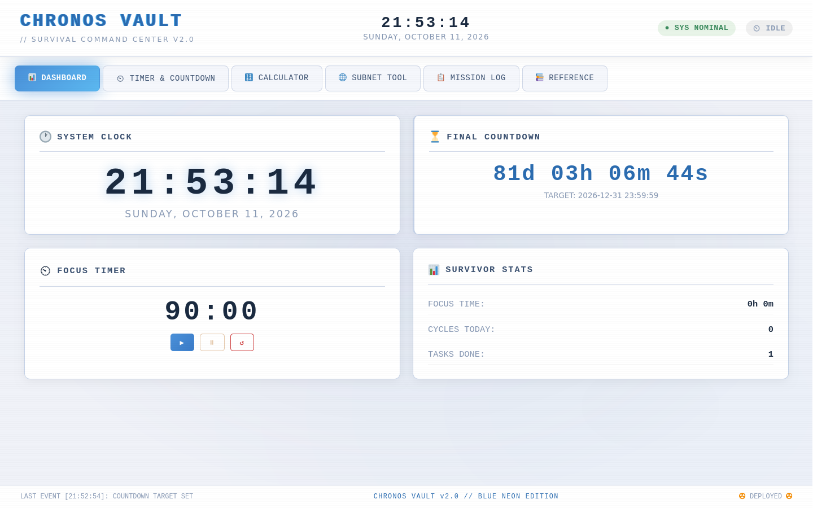

# Chronos Vault — Network Survival Dashboard

A survival dashboard for network engineers and IT students.
No frameworks. No server. Pure HTML, CSS, and JavaScript.

## Features
- Pomodoro focus timer with break cycles
- Subnet calculator with CIDR reference
- Standard calculator
- Task manager (Mission Log)
- Live clock and countdown timer

## Tech
HTML · CSS · Vanilla JavaScript

## by Anas Ait Baani - @0x9z
